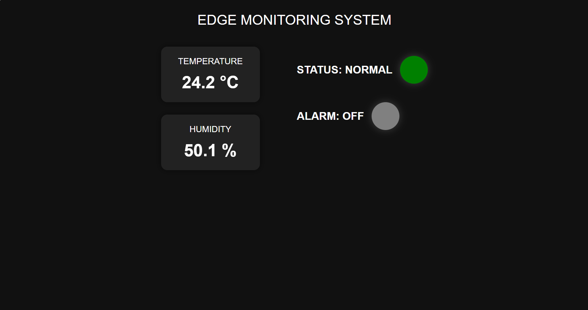

# Edge Monitoring System

## Project Overview

This project is a local edge monitoring system designed to monitor environmental temperature and humidity in real time.

The system combines:

- Arduino Mega
- DHT11 Temperature & Humidity Sensor
- RGB Status LED
- Active Buzzer
- Raspberry Pi
- Python Flask Web Server

---

## Hardware Setup

The following components are connected to the Arduino Mega:

- DHT11 Sensor
- RGB LED
- Active Buzzer

The Arduino continuously reads:

- Temperature
- Humidity

and generates different alarm states based on temperature thresholds.

---

## Alarm States

| Temperature Range | Status | Alarm Behavior |
|---|---|---|
| < 25.3°C | NORMAL | Green LED |
| 25.3°C - 28°C | WARNING | Yellow LED |
| 28°C - 30°C | CRITICAL | Red LED + Slow Alarm |
| > 30°C | HIGH CRITICAL | Red LED + Fast Alarm |

---

## Raspberry Pi Integration

The Arduino is connected to a Raspberry Pi via USB serial communication.

The Raspberry Pi receives real-time sensor data from the Arduino and processes it using Python.

---

## Web Monitoring System

A local web-based monitoring interface was developed using Flask.

The web interface displays:

- Real-time temperature
- Real-time humidity
- System status
- Alarm state
- Visual alarm indicators

The monitoring page can be accessed locally through the Raspberry Pi IP address.

Example:

```text
http://192.168.31.230:5000
```

---
## Web Interface Screenshot



## Technologies Used

- Arduino C++
- Python
- Flask
- PySerial
- HTML/CSS

---

## Required Python Packages

Install dependencies using:

```bash
pip install -r requirements.txt
```

---

## Run Application

Navigate to the python folder:

```bash
cd python
```

Run the Flask application:

```bash
python app.py
```

---

## Project Structure

```text
Edge-Monitoring-System/
│
├── arduino/
│   └── temp_alarm_system.ino
│
├── python/
│   ├── app.py
│   ├── requirements.txt
│   └── templates/
│       └── index.html
│
└── README.md
```

---

## Future Improvements

- MQTT integration
- Data logging
- Historical charts
- SQLite database
- Multi-sensor support
- Docker deployment
